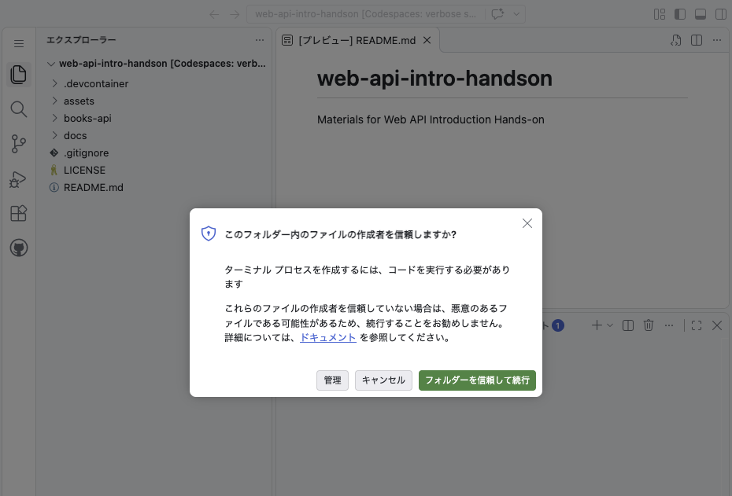

# 【実習】ハンズオン手順書

**実習環境**：GitHub Codespaces（受講者のPCへのインストールは不要）
**使用技術**：Python 3.12 / FastAPI / Uvicorn
**題材**：本（book）を管理するシンプルなREST API

---

## この実習のゴール

自分の手で、次の3つのエンドポイントを持つWeb APIを動かせるようになります。

| メソッド | パス | 役割 |
|---|---|---|
| GET | `/books` | 本の一覧を取得する |
| GET | `/books/{book_id}` | 本を1件取得する |
| POST | `/books` | 本を新しく追加する |

実際に作ったAPIをコールして、HTTPヘッダー、ボディ、メソッド、ステータスコードへの理解を深めます。

---

## 1. 環境確認

### 実習環境：GitHub Codespaces

本実習の事前準備内容は[こちら](participant-prep.md)です（GitHubアカウント作成が唯一の必須作業です）。

本実習は **GitHub Codespaces** で行います。ブラウザ上でVS Code・ターミナル・Python・FastAPIがすべて揃った状態から始められます。

### 環境の起動手順

1. 本レポジトリの緑色の **「Code」** ボタン → **「Codespaces」** タブ → **「Create codespace on main」** をクリックします
2. ブラウザ上にVS Codeが起動します（初回は1〜2分かかります）
     - 途中、フォルダー内コンテンツの作成者を信頼するか確認するプロンプトが表示されるので、「フォルダーを信頼して続行」ボタンをクリックします
     
3. 起動が完了すると、FastAPI・uvicornは**インストール済み**の状態になっています

> 📝 依存関係の自動インストールとバージョン固定
>
> `.devcontainer/devcontainer.json` の `postCreateCommand` で依存関係を自動インストールしています。
> バージョンは `.devcontainer/requirements.txt` で固定済みです（fastapi 0.115.6 / uvicorn 0.34.0）。
> これにより、「昨日まで動いていたのに今日は動かない」という事故が起きにくくなります。

### 環境が起動したことの確認

画面下部のターミナルで、以下を実行して確認します。

```bash
python --version          # Python 3.12.x と表示される
python -m uvicorn --version   # uvicorn のバージョンが表示される
```

> 📝 起動コマンド `python -m uvicorn ...` について
>
> `uvicorn` 単体でも動きますが、`python -m uvicorn` の場合は、Pythonが属する環境にインストールされたuvicornモジュールを実行します。そのため、現在使っているPython環境のUvicornを確実に起動でき、トラブルが少なくなります。`uvicorn ...` で実行する場合は、`PATH` 上で最初に見つかったuvicornコマンドを実行するため、別の仮想環境やグローバル環境のものを誤って使う可能性があります。

### 作業フォルダーに移動する

```bash
cd books-api
```

このフォルダーに `main.py` を作っていきます。

> 📝 リポジトリには、疎通確認用のエンドポイントを実装した `books-api/main.py` があらかじめ用意されています。
> 本実習では、このファイルにコードを追記しても、一度内容を削除してから実装し直しても、どちらでも問題ありません。

### 題材について

本実習では、「本を管理するAPI」を作成します。書籍データはデータベースを使用せず、プログラム内の **リスト（配列）** に保持して管理します。

---

## 2. GETエンドポイントを作る

作業フォルダーに `main.py` を作成し、まずは「一覧取得」と「1件取得」を書きます。

```python
from fastapi import FastAPI, HTTPException

app = FastAPI(title="Books API", description="本を管理するシンプルなREST API")

# 本を保存しておく場所（今回はメモリ上のリストで代用）
books = [
    {"id": 1, "title": "はじめてのWeb API", "author": "山田太郎"},
    {"id": 2, "title": "RESTがわかる本", "author": "鈴木花子"},
]


# 一覧を取得する（GET /books）
@app.get("/books")
def get_books():
    return books


# 1件だけ取得する（GET /books/{book_id}）
@app.get("/books/{book_id}")
def get_book(book_id: int):
    for book in books:
        if book["id"] == book_id:
            return book
    # 見つからなければ 404 を返す
    raise HTTPException(status_code=404, detail="本が見つかりません")
```

### サーバーを起動する

```bash
python -m uvicorn main:app --reload
```

- `main` … ファイル名（`main.py`）
- `app` … コード内の `app = FastAPI()` の変数名
- `--reload` … コードを保存すると自動で再起動（開発用に便利）

起動に成功すると `Uvicorn running on http://127.0.0.1:8000` と表示されます。

### ブラウザで確認（Codespacesのポートフォワード）

Codespacesはクラウド上で動いているため、**自分のPCのブラウザに `127.0.0.1:8000` と入力しても開けません**。
代わりに、Codespacesが自動で発行する**公開URL**を使います。

1. サーバーを起動すると、画面右下に「ポート8000が利用可能になりました」という通知が出ます
2. 通知の **「ブラウザーで開く」** をクリックします
3. 新しいタブで `https://＜ランダムな文字列＞-8000.app.github.dev` のようなURLが開きます

通知を見逃した場合は、ターミナル横の **「ポート」タブ** から、ポート8000の「ローカルアドレス」にカーソルを合わせて地球儀アイコンをクリックしても開けます。

このURLの末尾にパスを付けて動作を確認します。

- `＜公開URL＞/books` → 本の一覧（JSON）が表示されます
- `＜公開URL＞/books/1` → id=1 の本だけが表示されます

> 📝 APIアクセス用のURLについて
>
> サーバーはクラウドの中で `127.0.0.1:8000` として動いていて、Codespacesがそれを外から見えるURLに橋渡ししてます。
> ターミナルの表示（127.0.0.1）とブラウザのURL（app.github.dev）が違っているのはこのためです。
>
> なお、初期状態のポートは**Private**（本人だけがアクセス可能）です。受講者同士でURLを共有させたり、別のAPIクライアントツール（例: Postman）からアクセスする場合は、
> 「ポート」タブで右クリック →「ポートの表示範囲」→「Public」に変更してください。

### 自動生成ドキュメントを見せる

> 📝 FastAPIの`＜公開URL＞/docs` と `/openapi.json`
> 
> `＜公開URL＞/docs` を開くと、FastAPIがAPIコードの内容を元に自動生成したAPIドキュメントが表示されます。さらに、`＜公開URL＞/openapi.json`を開くと、このAPIのOpenAPI仕様が表示されます。

### コード解説

- `@app.get("/books")` の "get" と "/books" はメソッドとパスを表します
- URLの `{book_id}` が関数の引数 `book_id` に渡ってきます（パスパラメーター）
- `book_id: int` と型を書くと、数字以外が来たとき自動でエラーにしてくれます

---

## 3. POSTでデータを追加する

「本を追加する」機能を足します。POSTでは**リクエストボディ（JSON）**でデータを受け取ります。受け取るデータの形を `BaseModel` で定義するのがFastAPI流です。

`main.py` の先頭付近と末尾に、以下を追記します。

```python
from fastapi import FastAPI, HTTPException
from pydantic import BaseModel   # ← 追加

app = FastAPI(title="Books API", description="本を管理するシンプルなREST API")


# リクエストで受け取る本の情報の「形」を決める
class BookIn(BaseModel):
    title: str
    author: str


books = [
    {"id": 1, "title": "はじめてのWeb API", "author": "山田太郎"},
    {"id": 2, "title": "RESTがわかる本", "author": "鈴木花子"},
]
next_id = 3   # 次に追加する本のID


@app.get("/books")
def get_books():
    return books


@app.get("/books/{book_id}")
def get_book(book_id: int):
    for book in books:
        if book["id"] == book_id:
            return book
    raise HTTPException(status_code=404, detail="本が見つかりません")


# 新しい本を追加する（POST /books）
@app.post("/books", status_code=201)
def create_book(book: BookIn):
    global next_id
    new_book = {"id": next_id, "title": book.title, "author": book.author}
    books.append(new_book)
    next_id += 1
    return new_book
```

### コード解説

- `class BookIn(BaseModel)` … 受け取るJSONは `title` と `author` を持つ、という「約束」です
- `status_code=201` は「新しく作成した」ことを表すステータスコードです
- `id` はクライアントに指定させず、サーバー側で採番します

> 📝 `--reload` で起動していれば保存するだけで反映されます。ここで `/docs` を再度開くと、POSTが追加され、ブラウザ上から「Try it out」で実行もできます。

---

## 4. APIクライアントで動作確認

GETはブラウザで確認できますが、POSTはブラウザのアドレスバーからは送れません。そこで**APIクライアント**を使います。
まずは、`/docs` のAPIドキュメントページから実行して、そのあとに同じことを `curl` で再現する、という順で進めます。

### ① `＜公開URL＞/docs` から実行する（まずはこれ）

1. ブラウザで `＜公開URL＞/docs` を開きます
2. **POST /books** の行をクリックして展開します
3. 右上の **「Try it out」** をクリックします
4. Request bodyの欄を、以下のように書き換えます

   ```json
   {
     "title": "テスト駆動API入門",
     "author": "田中三郎"
   }
   ```

5. **「Execute」** をクリックします
6. 下に表示される **Server response** を確認します
   - **Code** が `201` になっています
   - **Response body** に `"id": 3` の本が返っています

7. 続けて **GET /books** を同じ手順で実行し、追加した本が一覧に入っていることを確認します

### ② curl で同じことをする

「GUIがやっているのは、結局この通信です」と示すパートです。
Codespacesのターミナルで実行するので、**ここでは `127.0.0.1:8000` を使います**（サーバーと同じマシンの中から呼ぶためです）。

サーバーは起動したままにしておきたいので、**ターミナルをもう1枚開きます**。

- ターミナル右上の **「+」** をクリックすると、新しいターミナルが開きます
- 開いたら `cd books-api` で作業フォルダーに移動しておきます

```bash
# 1) 一覧を取得（GET）
curl http://127.0.0.1:8000/books

# 2) 1件取得（GET）
curl http://127.0.0.1:8000/books/1

# 3) 本を追加（POST） ※ヘッダーでJSONだと伝え、-d でボディを送る
curl -X POST http://127.0.0.1:8000/books \
  -H "Content-Type: application/json" \
  -d '{"title": "テスト駆動API入門", "author": "田中三郎"}'

# 4) 追加されたか、もう一度一覧を取得して確認
curl http://127.0.0.1:8000/books
```

期待される結果：3) で新しい本が返り、4) の一覧に追加された本が含まれています。

> 📝 IDは実習中にPOSTした回数で変わります（初回なら `id: 3` です）。

### ③ ステータスコードも見てみる

```bash
# -i を付けるとレスポンスヘッダー（ステータスコード）も表示される
curl -i http://127.0.0.1:8000/books/1
```

先頭に `HTTP/1.1 200 OK` と表示されます。POSTで追加したときは `201 Created` になることも確認します。

> 📝 Codespacesのターミナルは**Linuxのbash**なので、シングルクォートがそのまま使えます。
> 従来のWindows/PowerShellのクォート問題は、Codespacesを使うことで発生しません。


時間に余裕がある人は、下記のGUI APIクライアントでも同じPOSTを送ってみましょう。その場合は**公開URL**（`https://...app.github.dev`）を使い、ポートを**Public**に変更しておくことをお忘れなく。

https://www.postman.com/tools/rest-api-client

---

## 5. わざとエラーを起こしてみる

「うまくいく」だけでなく「失敗したときにどう返るか」を体験します。エラーは敵ではなく、**クライアントに状況を正しく伝える大事な仕組み**であることを理解してもらいます。

以下はcurlの例ですが、**`/docs` の「Try it out」でも同じことを再現できます**（②③はブラウザからのほうが分かりやすいです）。
curlがうまく打てない受講者には `/docs` 側で試してもらい、全員がステータスコードを目にできる状態にします。

### ① 存在しない本を取得 → 404

```bash
curl -i http://127.0.0.1:8000/books/999
```

結果：`HTTP/1.1 404 Not Found` と `{"detail":"本が見つかりません"}` が返ります。
→ コード中の `raise HTTPException(status_code=404, ...)` が効いています。

### ② 数字でないIDを指定 → 422（自動バリデーション）

```bash
curl -i http://127.0.0.1:8000/books/abc
```

結果：`HTTP/1.1 422 Unprocessable Entity` が返ります。
→ `book_id: int` と型を書いたおかげで、FastAPIが自動で弾いてくれます。

### ③ 必須項目が足りないPOST → 422

```bash
# author を送らずに追加しようとする
curl -i -X POST http://127.0.0.1:8000/books \
  -H "Content-Type: application/json" \
  -d '{"title": "著者がない本"}'
```

結果：`422` と「author が必要」という趣旨のエラーが返ります。
→ `BaseModel` で `author: str` を必須にしているためです。

### まとめの問いかけ

- 200・201・404・422 はそれぞれ「誰の」「どういう状況」を表していますか？
- エラーメッセージが分かりやすいと、APIを使う相手（人間もAIも）はどのように助かりますか？
  → 第4章「AIにとって使いやすいAPI」へつなぎます

---

## 付録A. 完成版 `main.py`（全文）

```python
from fastapi import FastAPI, HTTPException
from pydantic import BaseModel

app = FastAPI(title="Books API", description="本を管理するシンプルなREST API")


# リクエストで受け取る本の情報の「形」を決める
class BookIn(BaseModel):
    title: str
    author: str


# 本を保存しておく場所（今回はメモリ上のリストで代用）
books = [
    {"id": 1, "title": "はじめてのWeb API", "author": "山田太郎"},
    {"id": 2, "title": "RESTがわかる本", "author": "鈴木花子"},
]
next_id = 3


@app.get("/books")
def get_books():
    return books


@app.get("/books/{book_id}")
def get_book(book_id: int):
    for book in books:
        if book["id"] == book_id:
            return book
    raise HTTPException(status_code=404, detail="本が見つかりません")


@app.post("/books", status_code=201)
def create_book(book: BookIn):
    global next_id
    new_book = {"id": next_id, "title": book.title, "author": book.author}
    books.append(new_book)
    next_id += 1
    return new_book
```

## 付録B. 実行手順まとめ（1枚チートシート）

```bash
# 1. 環境を開く（ブラウザ）
#    https://github.com/yokawasa/web-api-introduction
#    → Code → Codespaces → Create codespace on main
#    ※ FastAPI / uvicorn はインストール済み

# 2. 作業フォルダーへ移動して main.py を作成（付録A）
cd books-api

# 3. 起動
python -m uvicorn main:app --reload
#    → 右下の通知「ブラウザーで開く」から公開URLを開く
#    → ＜公開URL＞/docs で自動ドキュメントが見られる

# 4. 動作確認（ターミナルをもう1枚開いて実行）
curl http://127.0.0.1:8000/books
curl http://127.0.0.1:8000/books/1
curl -X POST http://127.0.0.1:8000/books \
  -H "Content-Type: application/json" \
  -d '{"title":"テスト駆動API入門","author":"田中三郎"}'

# 5. エラー体験
curl -i http://127.0.0.1:8000/books/999   # 404
curl -i http://127.0.0.1:8000/books/abc   # 422
```

### URLの使い分け（最重要）

| どこから叩くか | 使うURL |
|---|---|
| Codespacesのターミナル（curl） | `http://127.0.0.1:8000` |
| 自分のPCのブラウザ / Postman | `https://＜ランダム文字列＞-8000.app.github.dev` |

## 付録C. よくあるつまずき

### Codespaces環境まわり

| 症状 | 原因 | 対処 |
|---|---|---|
| ブラウザで `127.0.0.1:8000` が開けない | Codespacesはクラウド上で動いているため | 「ポート」タブから**公開URL**を開きます。最頻出のつまずきです |
| ポート通知を見逃した | 通知が自動で消えた | ターミナル横の「ポート」タブから、ポート8000の地球儀アイコンをクリックします |
| 公開URLで `502` が出る | サーバーがまだ起動しきっていない | 数秒待ってリロードします。ターミナルに `Application startup complete` が出ているか確認します |
| 公開URLを他人と共有できない | ポートが Private のまま | 「ポート」タブで右クリック →「ポートの表示範囲」→「Public」に変更します |
| Codespaceの作成に失敗する | 無料枠超過 / 組織のポリシー | 個人アカウントで再試行します。できない場合は付録Dのローカル手順を実施します |
| しばらく放置したら切断された | 30分無操作で自動停止 | ブラウザをリロードすれば再開できます（**書いたコードは消えません**） |
| ターミナルが見当たらない | パネルが閉じている | 上部メニュー →「Terminal」→「New Terminal」を選択します |

### アプリケーションまわり

| 症状 | 原因 | 対処 |
|---|---|---|
| `uvicorn: command not found` | PATHが通っていない | `python -m uvicorn main:app --reload` で起動します（本資料はこの形で統一しています） |
| `Address already in use` | 前のサーバーが残っている | 元のターミナルで `Ctrl + C` を押します。または `--port 8001` で別のポートを指定します |
| `Error loading ASGI app` | `main.py` のある場所にいない | `cd books-api` を実行してから起動します |
| POSTで`422`が出続ける | JSONの形やヘッダー不足 | `Content-Type: application/json` とキー名を確認します。`/docs` から送ってもらうのが確実です |
| コード変更が反映されない | `--reload` を付けていない | 起動コマンドに `--reload` を追加します |
| `IndentationError` が出る | Pythonのインデントずれ | 半角スペース4つで揃っているか確認します |

## 付録D. ローカル環境で実施する場合（代替手順）

Codespacesが使えない人向けの代替手順です。

### 手順

```bash
# 1. リポジトリを取得
git clone https://github.com/yokawasa/web-api-introduction.git
cd web-api-introduction/books-api

# 2. 仮想環境を作って有効化
python -m venv .venv

#   macOS / Linux
source .venv/bin/activate
#   Windows（PowerShell）
.venv\Scripts\Activate.ps1

# 3. ライブラリをインストール
pip install -r ../.devcontainer/requirements.txt

# 4. 起動
python -m uvicorn main:app --reload
#   → ブラウザで http://127.0.0.1:8000/docs
```

ローカルの場合は `127.0.0.1:8000` を**そのままブラウザで開けます**（ポートフォワードの話は不要です）。

### Windows（PowerShell）でのcurl注意点

PowerShellの `curl` は `Invoke-WebRequest` の別名なので、本資料のコマンドはそのままでは動きません。
`curl.exe` と明示し、**ダブルクォートをエスケープ**します。

```powershell
curl.exe -X POST http://127.0.0.1:8000/books `
  -H "Content-Type: application/json" `
  -d '{\"title\":\"テスト駆動API入門\",\"author\":\"田中三郎\"}'
```

---

*本資料のサンプルコードは動作ロジックを検証済みです（GET一覧=200 / GET1件=200 / 存在しないID=404 / POST追加=201）。*
